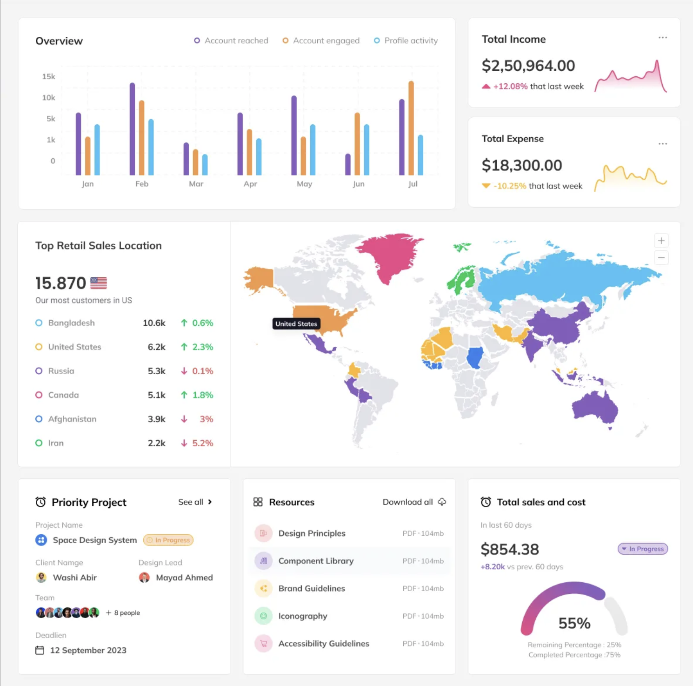

# PianoLIT analytics design direction

User preferences recorded on 2026-10-13 for future administration analytics work.

Retain the established full-screen gray canvas, dark navigation and softly rounded,
white-bordered cards. Use PianoLIT's shared typography tokens: 16px primary text and
controls, 14px secondary text, and the existing heading scale. Fit smaller screens
by wrapping or scrolling content rather than shrinking readable text.

Redesigned admin tables and paginated lists default to 12 results per page. Use
`App\Support\AdminPagination::PER_PAGE` for server pagination and retain independent
page parameters, filters and ordering. This default is separate from compact,
non-paginated dashboard rankings and bounded journey detail queries.

Use clear, literal headings and descriptions. Name the data directly, such as
Where our users are, Users by country, Activity summary, or Visit summary. Avoid
clever labels, metaphors, storytelling language and calling all users pianists.
Apply this wording preference to future admin and analytics pages as well.

The reference establishes these preferred patterns:

- Grouped bars with narrow, rounded ends, generous space between groups, a clear
  legend and light dashed gridlines. Show dates/categories and a numbered scale;
  expose exact values without depending on hover alone.
- Compact metric cards with a large total, a clearly labeled comparison and a soft
  sparkline. Curves use a fine colored stroke and a faint fill that fades toward
  the baseline.
- A wide country-map card with a country ranking and prominent selected-country
  count alongside a clean SVG world map. Use muted neutral countries, coordinated
  pastel country colors, fine white borders, exact hover/selection counts and
  unobtrusive zoom/reset controls. Country list colors must match the map.
- Rounded progress/gauge arcs with a muted remaining track, clear percentages and
  an explicit denominator or completion definition.

The existing coral/yellow/lime gradient remains appropriate for Overview highlights.
For contrasting chart series, the map introduces coordinated peach (#efb07c),
lavender (#a692ce), sky (#83c9df), rose (#e8a6c0), gold (#e8ce87) and mint (#94c6b0).
Other mapped countries use pale sage (#bfd6bb); unpopulated shapes stay neutral.
These map colors identify the six leading countries, rather than implying a
continuous density scale.

Keep the meaning of each metric visible. Use real values; add a trend/comparison
only when the corresponding periods and source data exist. Overview's country
card counts all current registered accounts by their saved country code, separately
from activity-period/platform filters. Coverage and unknown countries are explicit.
Saved IP-derived country locations describe recorded locations, not nationality
or a live presence count. Generalized geometry can omit separate small territories;
their account counts still appear in the country list and table.

Chart.js remains available for existing charts and can be styled to follow this
reference. The new map uses local pre-generated SVG geometry, produced with D3
geography utilities at build time; it adds no browser chart-library dependency.
Choose another rendering tool only when a requested chart needs it, keeping existing
pages and mobile contracts compatible.

On 2026-10-13 the user also supplied a dark overlapping-bar reference and a light
grouped-bar reference for the daily Users analytics chart. Daily activity uses
grouped bars for Visits, Pieces opened and Media starts: the measures count different
things and do not form parts of a meaningful combined total. Shared baselines make
comparisons clearer. Use consistent mint, lavender and peach series colors, rounded
tops, exact counts above bars and the page's light surfaces. Retain readable dates,
a single count scale and a full-date details table for long ranges.

On 2026-10-13 the user supplied an additional [dashboard and gauge reference](design/analytics-gauges-reference.webp)
for the Pieces analytics redesign. Use a variety of relevant graph styles: fine
area/line trends, rounded grouped bars, pastel doughnuts with exact legends,
semicircular coverage gauges, horizontal rankings, a colored country map and a
classification heatmap. The chart should fit the data: categories share a common
denominator, subset bars are not added to their parent counts, and missing or
conflicting classifications remain visible. The repertoire page follows this
pattern; see PIECE_ANALYTICS.md for its metric definitions.
